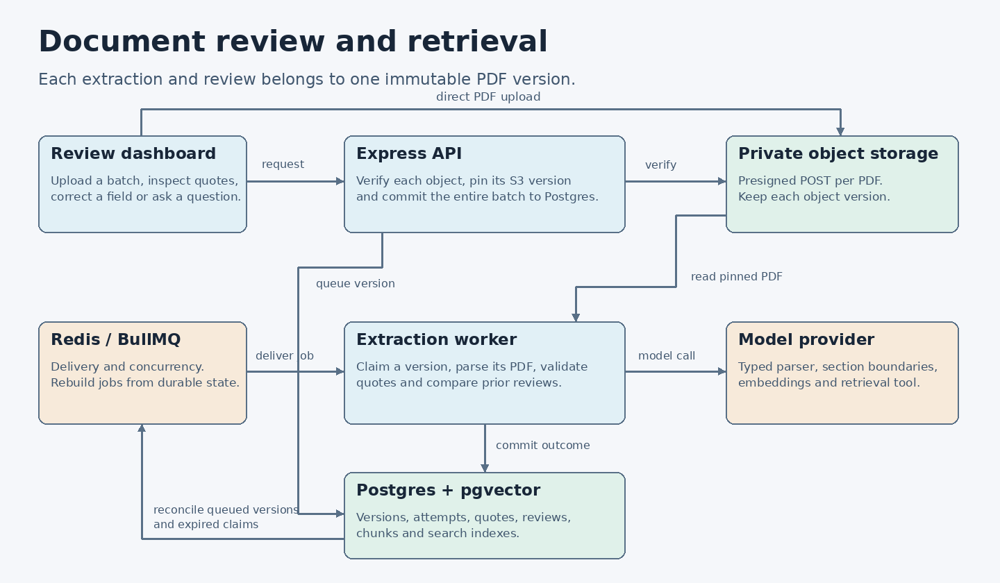

# Lomi document review

Upload a PDF, compare each extracted value with its exact source passage, and approve or correct it. When a revision arrives, the reviewer can see which evidence changed and open the earlier version.

[Hosted demo browser walkthrough](docs/browser-walkthrough.md)

## Run it

Use Docker Compose v2. For live extraction, copy `.env.example` to `.env` and set `OPENAI_API_KEY`. The provider must support structured Chat Completions, function calls and 1,536-dimensional embeddings. Set `OPENAI_BASE_URL`, `OPENAI_MODEL` and `EMBEDDING_MODEL` to models available to your account. The requested chat model defaults to `gpt-6.2-luna`.

```sh
docker compose up
```

Open [the reviewer dashboard](http://localhost:3000). Compose applies migrations, creates a private versioned local S3 bucket and queues version 1 of each fixture. Without a provider key, extraction settles in **Failed** with a setup message. After changing provider settings, run `docker compose up -d` to recreate the affected containers, then click **Retry extraction**.

1. Open **Invoice — Meridian Office Supplies**. Approve four fields and correct the vendor name. The quote and extracted vendor remain visible beside the correction.
2. Select **Upload revision** and choose `fixtures/documents/invoice-001.v2.pdf`. The due date and total amount should return to pending. The other three reviews should carry over. Select v1 to inspect its original text and reviews.
3. Open the market report. The missing household income should appear as a gap with a reason.
4. Use **Ask documents** to ask about a value. Open a citation to inspect its version, evidence and review status.

The API listens on [localhost:4000](http://localhost:4000/health). Multipart uploads to `POST /documents` take a `file` and a `type` of `invoice`, `lease` or `market_report`. The dashboard uses direct signed uploads with configurable defaults of 10 PDFs and 10 MiB per PDF. It can retry a partial batch. A version becomes eligible for extraction after the whole batch has been verified. A revision during a queued or running extraction receives HTTP 409. Sensitive endpoints return 429 with a retry window. See the [HTTP contract](packages/api/openapi.yaml).

## How a revision survives a restart

S3 keeps the PDF bytes. Postgres records a logical document, immutable numbered versions and the S3 version ID for each. Each expected field has one row per version, containing a value and verified quote or a gap reason. Reviews are annotations. A correction preserves the model output. Gaps have no supporting evidence and get reviewed again on revision.

The API commits queued work in Postgres before responding. The worker offers outstanding versions to BullMQ, obtains a time-limited Postgres claim, reads the pinned PDF and calls the type-specific parser. The model proposes section boundaries in the original text. The worker embeds those sections and enriches their metadata. Values, chunks, carried reviews and the extracted state commit in one transaction. A stale claim cannot overwrite a newer attempt. A worker restart or Redis flush can cause another provider call. The version and field identities keep the persisted result unique.

A field carries its prior review when its validated quote is byte-for-byte equal in both parsed versions. Moving the quote does not change its identity. If the model selects a different span, the field conservatively returns to pending. Earlier version reviews become read-only when a revision is accepted. Six-second polling keeps the document and its progress current. [Design decision](docs/adr/0001-versioned-extraction.md) · [Editable diagram](docs/architecure.excalidraw)



## Code and verification

| Location                                                             | Responsibility                                                                                                                      |
| -------------------------------------------------------------------- | ----------------------------------------------------------------------------------------------------------------------------------- |
| `apps/frontend`                                                      | Next.js reviewer, batch upload, document history and citations                                                                      |
| `apps/backend`, `packages/api/v1`                                    | Express entry point, fixture seed, HTTP contracts and batch acceptance                                                              |
| `apps/worker`                                                        | Queue reconciliation, claim renewal and extraction                                                                                  |
| `packages/drizzle`                                                   | Schema, migrations, transactions, review carry-over and search                                                                      |
| `packages/services`                                                  | PDF parsing, object storage, model prompts, evidence checks and retrieval                                                           |
| `packages/config`, `common`, `types`, `validators` under `packages/` | Configuration, HTTP errors, shared types and Zod schemas                                                                            |
| [infra/modules/aws/s3](infra/modules/aws/s3/README.md)               | Terraform module for the PDF bucket and document IAM roles, with MinIO policies and initialization for local Compose under `local/` |

For development use Node 24, pnpm 10.28 and Poppler (`pdfinfo` and `pdftotext`). Run `pnpm install --frozen-lockfile` and then `pnpm test`, `pnpm lint` or `pnpm build`. Turbo runs the corresponding workspace tasks. The standalone recovery test uses a deterministic provider to exercise failure boundaries without billing a model account. [Integration test](tests/integration/README.md) · [Browser checks and screenshots](apps/frontend/README.md) · [Classifier measurements](packages/services/README.md) · [Load scenarios](tests/bench/README.md)

## AWS deployment

GitHub Actions runs application, browser, recovery and Terraform checks on pull requests. Separate staging and production workflows deploy one `t3.medium` per environment. Production promotion requires a verified staging deployment of the same commit on `main`. [GitHub Actions setup](infra/github-actions.md) · [Terraform deployment and recovery](infra/README.md)

## Limits and next measurements

This is a single-reviewer local stack with loopback ports. It supports text PDFs and a bounded model context. OCR, reviewer identity and tenant isolation are outside this implementation. Configure authentication, retention of uploaded objects and access controls for prompts and raw responses before exposing client documents. The AWS Terraform module provisions private storage with public access blocked, HTTPS enforcement, restricted signing permissions and a version-read-only worker role.

At 10,000 documents the unpaginated library and periodic progress queries deserve measurement first. Compare list latency, submission latency, time waiting for a claim, provider latency and end-to-end completion under sustained load. Use those results to size workers, introduce pagination or change the reconciliation query. The classifier timing in this checkout covers local regex performance. The [captured fixture review](apps/frontend/evidence/revision-fixture.png) shows two pending fields after a model-double extraction and database-backed carry-over. Live model timings, the full Compose restart/flush run, the browser upload test and sustained load measurements are pending.

[Codex session transcript](https://gist.github.com/rshdhere/90a43fc37023e22aeb29ce1cff92f26a)
