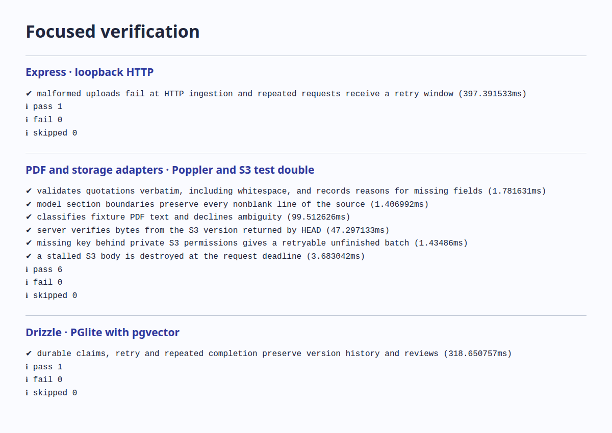

# HTTP server and fixture bootstrap

Compose runs the seed command after Postgres and private object storage are ready. It applies migrations and accepts only version 1 of each fixture into the durable extraction queue. Rerunning the seed skips existing document IDs, including documents subsequently revised in the dashboard.

`src/app.ts` mounts the Express application. Routes and OpenAPI belong to [the API package](../../packages/api/v1/README.md). Extraction runs in a separate worker so neither its latency nor Redis availability controls whether a valid multipart upload receives a receipt.

