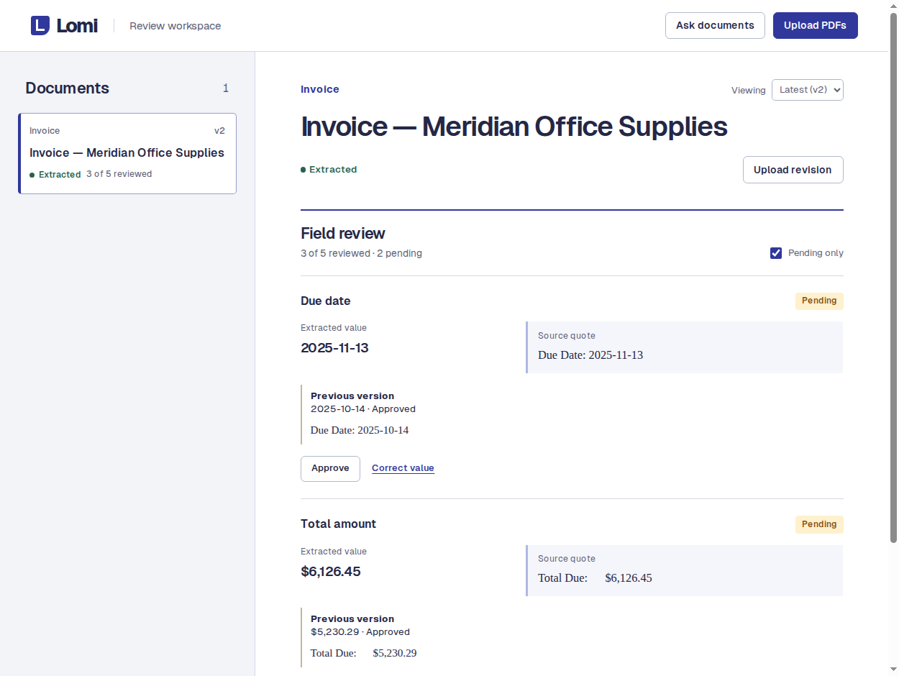

# Reviewer workspace

Open `http://localhost:3000` after starting the root Compose project. Search the library by document title or type. Each entry shows the extraction state, version, and number of fields reviewed. Select a document to compare its values with their source passages, then use **Pending only** to focus on outstanding reviews.

On a phone, **Browse** opens the document library and **Actions** contains **Upload PDFs** and **Ask documents**.

Approve a value as extracted, or select **Correct value**, enter the correction and optionally add a note. A gap includes its reason. Use **Upload revision** with `fixtures/documents/invoice-001.v2.pdf` after reviewing the original invoice. Check the carried-over reviews and the previous values beside the changed due date and total. The version menu opens earlier evidence and reviews.

**Upload PDFs** submits a batch directly to signed object storage destinations. If a file fails, **Continue batch** retries outstanding transfers. If a link expires, choose the files again. Extraction begins after the API confirms the batch. **Ask documents** searches across the collection or the selected document and links its quoted sources to their document versions.

The browser fetches the library and selected detail every six seconds. This keeps extraction state and reviews current while leaving an open correction form in place. Set `NEXT_PUBLIC_API_ORIGIN` when building for an API outside `http://localhost:4000`. The API and object store both need to allow requests from the dashboard origin.

## Browser verification and screenshots

With the seeded stack running and an extraction API key configured, run the following in the cloud checkout from the repository root.

```sh
pnpm --filter web exec playwright install --with-deps chromium
pnpm --filter web test:e2e
```

The Chromium tests run against the Compose stack. They upload an invoice, record approvals and a correction, upload a revision, verify two pending fields and three carried reviews, and open version 1 again. They also check the missing income field on the seeded report. The mobile test filters the library, checks keyboard focus after closing a dialog, and follows a citation to its document version. It uses a fixed answer to exercise citation navigation. Screenshots of each run are saved to `apps/frontend/evidence/`.

Hosted CI also saves `workspace-desktop.png`, `workspace-mobile.png`, and `query-mobile.png` in the browser job's **review-screenshots** artifact.

### Archived fixture review

The screenshot shows the reviewer with **Pending only** selected for invoice v2. Both original PDFs were parsed with Poppler, processed with the integration model double, and persisted through Drizzle in PGlite with pgvector. The capture mounted the dashboard component with its real CSS and replayed those database results to the browser. It covers the revision display. The Playwright test above also exercises upload, polling and review actions against Compose.


