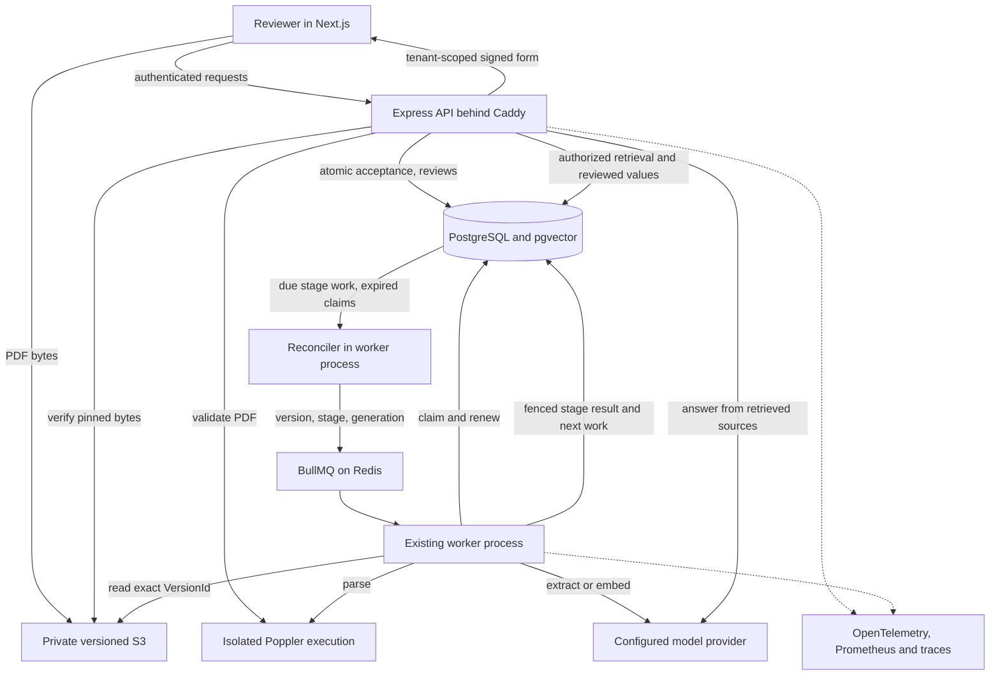

# Final v3 architecture and incremental production plan

**Design target · reviewed against checkout 73c072e.** The running implementation remains the baseline. The diagram shows the proposed end state. The priority tables identify the work required to get there. The assignment and its extension continue to govern compatibility. [Acceptance contract](../assignment.md) · [RAG extension](../SPEC.md) · [Existing design](adr/0001-versioned-extraction.md)

## Architecture

Keep the Next.js dashboard, Express, current worker executable, BullMQ, PostgreSQL/pgvector and private S3. The relay and the two job handlers belong in the existing worker. A job contains identifiers. PostgreSQL owns the work and user-visible outcome. S3 owns original bytes. A successful HTTP 202 follows the durable acceptance transaction. No correctness property depends on Redis surviving. Preserve three v1 seeds, explicit multipart types, configurable upload limits, the market_report wire type, historical read access, and exact same-field evidence carry-over. [Intake](../packages/api/v1/src/uploads.ts) · [Worker](../apps/worker/src/index.ts) · [Schema](../packages/drizzle/migrations/001_documents.sql)

## Critical · before opening access to independent customers

| Finding and consequence today | Incremental change | Verification gate |
|---|---|---|
| **Customer isolation.** The API is unauthenticated, the proxy allowlists IPs, and document, review, batch and retrieval queries have no tenant ownership. Knowing a resource ID can grant access inside the perimeter. | Introduce authenticated sessions, reviewer identity and membership. Add tenant ownership and tenant-consistent foreign keys to documents, versions, values, reviews, chunks, work and manifests. Backfill the existing installation to one explicit tenant before enforcing constraints. In every user transaction set tenant context locally, enable and force PostgreSQL RLS, and use a non-owner runtime role without BYPASSRLS. Keep the cross-tenant dispatcher restricted to claiming identifiers. Scope signing and both retrieval branches to authorized documents. Protect cookie-authenticated mutations against CSRF. | Two tenants with identically titled documents. Exercise list, historical read, review, retry, guessed batch completion, signing, lexical/vector search and citation resolution. Run the same checks via SQL as the runtime role, including missing tenant context and a pooled connection reused by a second tenant. |
| **Untrusted PDF processing.** Intake validates signatures, size, end marker and pdfinfo. Text extraction has time/output limits. Poppler still executes inside credentialed API/worker containers with shared memory and filesystem access. | Keep Poppler and move both validation and text extraction behind the same restricted execution boundary. Pass only bytes and receive bounded output. Give the parser no cloud credentials, DB access or network, and enforce process, memory, CPU, wall-time and temporary-storage budgets. Bound simultaneous intake parses independently of worker concurrency. | Use benign fixtures for malformed, encrypted, empty-text, oversize and deadline cases. Verify resource ceilings and network/credential isolation from deployment configuration. Saturate validation on disposable infrastructure and confirm unrelated reads remain responsive. |
| **Recoverability of customer records.** Daily EBS snapshots and version-pinned PDFs exist. The measured recovery test restarted original volumes. The restore runbook depends on the original bucket, model credentials and matching S3 versions. | Agree recovery time and maximum data loss with the owner. Restore a snapshot on an isolated host, verify credentials, migrations, object references, reviews and pending work, and record times. If the loss objective is shorter than the snapshot interval, add PostgreSQL point-in-time recovery. If bucket/account loss is in scope, retain an independently protected PDF copy and a mapping/restore procedure for original VersionIds. | Recover with the original DB disk unavailable. Verify historical corrected values and evidence against specific object bytes and hashes. Replay pending work. Record observed data loss and time to usable service. Exercise alternate-object recovery before claiming bucket-loss coverage. |

[API security contract](../packages/api/openapi.yaml) · [Storage validation](../packages/services/src/ingest.ts) · [Parser](../packages/services/src/pdf.ts) · [Runtime permissions](../infra/modules/aws/runtime/compose.yaml) · [Restore runbook](../infra/README.md) · [Recovery evidence](testing/2026-11-27/recovery.md)

## High · correctness and operational recovery

| Finding and consequence today | Incremental change | Verification gate |
|---|---|---|
| **Publication and starvation.** The queued version already acts as a transactional work record. No missing dual write needs fixing at acceptance. Each reconciler repeatedly offers the first 100 eligible rows, including jobs already waiting in Redis. At backlog this can waste scans and delay later offers. | When introducing indexing, generalize this into a small PostgreSQL stage-work table, unique on version, stage and generation. Insert extraction work with acceptance and indexing work with the extraction commit. Lease due publication rows in small ordered batches using SKIP LOCKED. Publish outside the transaction, using a deterministic BullMQ ID. Record next publication/recheck time. Keep a periodic scan of unfinished work, including previously published rows. A sent flag alone loses work after a flush. | Pause between DB commit and enqueue, and between enqueue and recording publication. Run two relays with more than 100 outstanding versions. Flush Redis after publication. After recovery every version completes or exposes an actionable failure, later rows receive service and the database contains one result per generation. |
| **Retrying uploads and stale revisions.** Batch completion replays a stored receipt. Manifest creation and multipart submissions allocate fresh keys. The parent-row lock prevents overlapping active revisions, but a second editor can submit v3 from a stale v1 once v2 finishes. | Add caller-scoped idempotency keys with payload fingerprints, uniqueness, expiry and receipt replay for create/revise operations. Reserve a single upload target per request and finalize against its pinned S3 version. Persist the expected base version with the manifest and check it under the document lock. Preserve 409 for busy/stale revisions and reject key reuse with different content. | Lose the response after commit and resend concurrently. Expect one version and the same receipt. Race two editors based on v1, including delayed completion after v2 finishes. Only one advances that base. Repeat independent intentional identical uploads under different keys. |
| **Classification on the acceptance path.** Untyped direct-upload completion can wait for a model call per file before returning. The multipart create path already requires a type. | Preserve explicit type selection and atomic batch acceptance. Try the existing high-confidence local classifier on a bounded parse at completion. Return the existing type-selection response for ambiguous files, or introduce asynchronous classification as an additive client capability. Measure type accuracy before changing the default. | Hold the provider unavailable and complete a mixed batch. Verify bounded response time, no partially published batch and correct type selection on retry. |
| **Abandoned bytes.** Signing expires in an hour. Batch rows expire after a day and are opportunistically deleted. Uploaded but unaccepted S3 versions can remain indefinitely. | Retain enough upload inventory for a tenant-scoped collector to reconcile object versions against accepted versions and live manifests. Use a grace interval, dry run and a separately authorized cleanup role. Serialize finalization versus expiry before permanent deletion. Keep retained history and backup retention explicit. | Abandon a batch, replay a signed upload, race completion with cleanup and reject a revision after storage verification. Assert that only expired, unreferenced versions become deletion candidates. |
| **Lease renewal and retries.** Tokens fence final commits and failure updates. A live heartbeat every 20 seconds can renew a 90-second lease even if useful progress stops. Provider throttling, transient storage failures and invalid PDFs normally share the failed/manual-retry path. | Add a stage deadline that heartbeats cannot extend, bounded provider calls, durable attempt count and next-attempt time, exponential backoff with jitter, and provider Retry-After handling. Classify transient and permanent errors. Limit automatic retries and expose exhaustion plus manual retry. Scope tokens to stage and generation. Abort local work when ownership is lost where possible. | Freeze progress while allowing heartbeat, force takeover, then resume the old worker. Inject a transient 429/503, invalid text and a long outage. Verify bounded attempts, no tight loops, no stale commits and a visible outcome. Kill after DB commit before queue acknowledgment and verify redelivery skips provider work. |
| **Extraction and indexing availability.** Today embeddings precede the single result transaction. An embedding outage withholds otherwise reviewable fields and a retry may repeat the extraction call. | Commit immutable parsed text, original candidates, gaps, spans, carry-over, section boundaries and durable indexing work together. Embedding jobs read that committed source. Write chunks/vectors to a generation and atomically activate only a complete generation. Add indexing status and retry separately. Keep existing extraction status values. Existing completed versions backfill as indexed, with reconciliation for missing artifacts. | Stop embeddings after extraction. Review must work, search must communicate indexing state, and retry must only embed. Kill mid-index and check partial generations never become searchable. Continue blocking revisions while extraction is queued/active. If indexing overlaps a revision, its writes must stay version-scoped. |
| **Evidence and immutability.** A substring check accepts a genuine quote containing a different total. Repeated occurrences are ambiguous. On identical evidence the code can store the old approved value in the new extracted row, leaving the new candidate only in the raw transcript. | Preserve model candidate and effective reviewed value separately. Store source offsets against immutable version text plus parser provenance. Select an occurrence only with verified location/context. Add field-specific checks for numeric amounts, currencies, units and dates, permitting documented equivalent formats. Unsupported or conflicting candidates become reasoned gaps or explicit pending ambiguities. Keep exact same-field quote equality as the carry rule for resolved evidence, independent of absolute position. Restrict writes to finalized source content. | Cover moved quotes, duplicate lines, changed punctuation, identical dates with different meanings, 50,000 against 45,000, and approved value differing from new candidate. Show raw candidate and effective value independently. Existing invoice v2 must still carry three reviews and return two to pending. |
| **Review audit and lost updates.** One upsert per value overwrites the previous decision. Two sessions can both report success. | Keep the effective review projection for existing readers. Append actor, timestamp, decision, note, prior decision and provenance in the same transaction. Require an expected review revision for identified clients. Record carry-over as a derived decision referencing the prior review. Mark legacy decisions as imported with unknown actor. | Race two browser sessions on one value. One update succeeds, the stale session sees a conflict and current decision. Verify append-only history, historical read-only behavior, and review-versus-revision serialization. |
| **Provider bounds and auditability.** The worker bounds characters but sends numbered full text, prompt and schema without a token preflight. Attempts keep prompt/raw content but omit usage and immutable model configuration. | Estimate tokens for the actual request and reserve output capacity. Expose an actionable over-budget outcome. Persist model/deployment identifier, prompt/schema/parser versions, timings, provider request ID and billed usage by operation/attempt, including embedding and both query calls. Coordinate worker concurrency with provider quotas. Protect transcripts with restricted access and retention. | Test near-limit multilingual text, rejected context and 429s. Compare estimates and recorded charges with a bounded provider run, including retries. Replay the old input/configuration and compare fields and evidence. Record nondeterminism separately from input drift. |
| **Failure diagnosis.** HTTP and extraction metrics, queue counts/age, expired leases and API-to-worker traces exist. The enrichment span combines model and embedding work. There are no checked-in paging rules for backlog or pool saturation. | Add queue wait by stage, provider latency/status, token use, retry exhaustion, publication lag, pool waits and index readiness. Correlate version/stage/attempt in restricted traces only. Alert on sustained oldest-work age, stalled progress, missing telemetry and failure bursts against agreed service objectives. Never label metrics with PDF text, prompts, user IDs or object keys. | Drive one slow provider response, pool exhaustion, Redis loss and an exporter outage on the isolated stack. Locate the delay from one receipt, confirm the intended alert fires and resolves, and inspect logs/traces for fixture secrets. |

[Batch SQL](../packages/drizzle/src/batches.ts) · [Version locks and review writes](../packages/drizzle/src/documents.ts) · [Claim, commit and retrieval SQL](../packages/drizzle/src/extraction.ts) · [Evidence validation](../packages/services/src/evidence.ts) · [Model calls](../packages/services/src/model.ts) · [Existing metrics](../packages/common/src/telemetry.ts)

## Medium · changes gated by compatibility and measurement

| Finding and consequence today | Incremental change | Verification gate |
|---|---|---|
| **Retrieval and citations.** One forced retrieval call chooses lexical or semantic, returns six chunks, and adds up to 20 reviewed fields. Semantic neighbors have no relevance floor. Valid source IDs can still support an incorrect claim. | Keep retrieval mandatory and the selected mode as a baseline. Trial a hybrid candidate set in PostgreSQL. Fuse lexical and cosine rank positions with reciprocal rank fusion, summing 1/(k + rank) per source and tuning k on held-out queries. Pin the eligible version/generation set for the whole retrieval, including the separate reviewed-field query, so a concurrent revision cannot mix source snapshots. Apply identical tenant and document filters to both branches. Prioritize current reviewed corrections as structured sources. Bind individual answer claims to backend-resolved versioned spans. For exact fields validate the cited value/unit, and abstain when unsupported. Allow historical comparison only for explicitly requested authorized versions. | Label fixture and representative questions with required passages, versions, corrections and expected abstentions. Compare recall@k, all-passage coverage, unsupported-claim rate, correction precedence, latency and cost against single-mode routing. Include ambiguous numbers, duplicate text, untrusted instructions and historical comparisons. |
| **Unbounded lists and database capacity.** Library queries expand progress for every document. Each process creates a pg.Pool with driver defaults. AWS PostgreSQL allows 60 connections. HNSW and GIN exist, but there is no measured million-chunk query plan. | Add opt-in cursor pagination with stable ordering/tie-breaker, computing progress after selecting the page. Make pool max and acquisition timeout explicit and budget all replicas plus admin/maintenance reserve. Capture EXPLAIN (ANALYZE, BUFFERS) for scoped vector, lexical, review, list and work scans. Add only indexes justified by plans. Assess a current-generation search index if history dominates. | Populate realistic tenant skew and historical revisions at 100k, 1M and several million chunks. Measure concurrent read/write p95/p99, recall versus exact vector search, pool waits, index size/build time, WAL, vacuum and restore time. Page under concurrent inserts and verify cursor semantics. |
| **API and deployment compatibility.** OpenAPI 1.0.0 is mounted at root. Old tabs can encounter a changed response. Strict Zod inputs help, but unknown server errors map to 503. One host runs six services and replacement interrupts traffic. | Ship additive schemas and old-reader defaults first. For example index-aware clients may review as soon as extraction finishes. Where existing consumers depend on extracted implying searchable, keep a legacy combined response until they migrate. Distinguish 500 defects, 503 dependencies and 401/403 access failures with stable codes. Add old-client/new-server contract tests, prior-image migration tests, isolated staging rollout and snapshot-backed rollback. | Run the previous client, previous worker and new binaries against an expanded populated schema. Validate API responses against OpenAPI, exercise queued jobs during rollout, then roll back application digests. Drop obsolete fields only after old code and browser clients leave service. |
| **Long-lived originals and derived data.** Parsed text, prompts, responses and vectors accumulate per version/attempt. There is no embedding rebuild or archival workflow. | Record embedding model and generation, rebuild alongside active data, switch atomically and garbage-collect after a rollback window. Define separate retention for source/reviews, transcripts, indexes and backups. Archive logically first. Account for previous-value links and tenant obligations in permanent deletion. | Rebuild while querying, compare retrieval results, roll back generation and restore an archived document with its evidence. Verify deletion inventory across database, object versions and retained backups. |

[Search and ranking](../packages/drizzle/src/extraction.ts) · [Answer validation](../packages/services/src/query.ts) · [Schema and indexes](../packages/drizzle/migrations/001_documents.sql) · [Pool](../packages/drizzle/src/client.ts) · [HTTP errors](../packages/api/v1/src/index.ts) · [Migration runner](../packages/drizzle/src/migrations.ts)

## Low · adopt only when a measured constraint justifies it

| Finding and consequence today | Conditional change | Verification gate |
|---|---|---|
| Full-document extraction and separate classification can repeat work. A SHA-256 hash exists, but equal bytes do not establish equal schemas, models or permissions. | Reuse a pinned parse within the upload/version when profiling shows material cost. Consider a tenant-local cache keyed by hash, parser configuration, model and schema versions. Preserve independent version outcomes and review lineage. | Show reduced calls or latency on duplicates, cache misses on configuration changes, and no cross-tenant exposure. |
| RRF may still retrieve distractors. A model reranker adds latency and another failure mode. | Trial reranking only the bounded authorized candidate set after hybrid retrieval has a measured baseline. Preserve an inexpensive fallback when it times out. | Promote only for a repeatable held-out citation/recall gain within agreed latency and cost limits. |
| Single-AZ EBS and a single host bound availability. Required failover times and rising workload determine when this becomes urgent. | If the target cannot tolerate host/AZ recovery time, move PostgreSQL to multi-AZ failover, use independent API/worker replicas with load balancing, and give Redis a failover deployment where queue rebuild time warrants it. Preserve DB fencing and reconciliation. Add an external pooler or partition chunks only after measured connection or query/storage pressure. | Fail an AZ under load, measure data loss and recovery against agreed objectives, verify no duplicate outcomes, and compare cost. Promote this work to critical if the availability contract demands it. |

## Capacity evidence and next benchmarks

The archived **one-hour** run was on an **r7i.2xlarge, eight logical CPUs**, with the client, PostgreSQL, Redis, object store, API, worker and deterministic three-second model on one host. It accepted **1,118 PDFs over the hour**. Every upload reused a **1,624-byte invoice**. Two extraction slots served the soak. The AWS t3.medium configuration uses **one slot**. The recorded run cannot establish t3.medium production throughput, real-provider capacity, WAN upload latency or resource use for large PDFs. A separate t3.medium run would need its own revision, host metadata and raw timings to support that claim. [Soak report](testing/2026-11-27/load.md) · [Run manifest](testing/2026-11-27/run.json) · [Generator](../tests/bench/soak.mjs) · [AWS runtime](../infra/modules/aws/runtime/README.md)

During peak, 880 PDFs were accepted, about 44/minute, versus 39.7 completions/minute. Up to 91 waited with two active. **134.25 s p95** measured upload-flow start to the first poll observing extraction among peak arrivals. A separate eight-invoice baseline measured **53.1 ms upload-to-202 p95** and **3.03 s claim-to-extracted p95**. The separate worker-kill and Redis-flush drill recovered v2 after **93.160 s**. These measurements use different populations and clocks. None establishes backup recovery time. [Baseline](testing/2026-11-27/baseline.json) · [Recovery drill](testing/2026-11-27/recovery.md)

| Proposed experiment | What to vary and record | Decision it enables |
|---|---|---|
| Production-sized host | Same revision and images on a disposable t3.medium. Run 1, 2 and 4 worker slots, with a separate generator, matched arrivals and repeats long enough to see CPU credit depletion. Mix tiny fixtures, representative multipage PDFs and near-limit inputs. Record CPU credits, RSS, swap, pool waits, storage I/O and queue age. | Choose concurrency with host and provider headroom. |
| End-to-end intake and recovery | Exercise both browser direct upload over network and multipart. Record presign, upload, verification/classification, DB acceptance, queue wait, parse, model, embed, commit and observed UI readiness separately. Inject client timeouts, relay crashes, PG/S3 interruptions and Redis loss with a backlog well above 100. | Establish tail latency, fair publication, financial retry exposure and recovery bounds. |
| Provider and RAG | Keep a deterministic baseline, then run a budgeted real-provider sample with representative lengths, types and question mix. Repeat under controlled quota pressure. Record quality, billed tokens, throttling and time to review/search independently. | Size provider budget and quota, and decide whether hybrid or reranking earns its cost. |
| Scale and restore | Load synthetic tenant/version distributions into disposable PostgreSQL, measure million-chunk retrieval during indexing, and restore the sized database plus required PDF versions. | Decide on index changes, storage retention, database sizing and HA using actual service objectives. |

Run heavy experiments in Codex Cloud against the exact candidate revision. Capture image digests, source digest, environment, arrival curve, model configuration, sample sizes, percentiles and failures. For a host-specific EC2 claim the system under test must actually be that EC2 size. Cloud-run measurements on different hardware are a separate result.

## Delivery sequence

1. **Establish the baseline and operating objectives.** Archive the tested revision, current API fixtures and existing recovery assertions. Agree intake latency, time to review/search, maximum loss and recovery objectives. Use separate thresholds for interactive and asynchronous work.
2. **Close access and recovery gaps.** Introduce identity/ownership, enforce tenant isolation, isolate parsing and perform a real restore before widening exposure. Keep the current single-reviewer workflow usable during the ownership backfill.
3. **Make writes safe to repeat.** Ship upload keys and expected revisions, then review audit and optimistic concurrency. Introduce bounded attempts and diagnostics behind existing status responses.
4. **Split extraction and indexing through durable stage work.** Add schema first, backfill completed versions, compare reconciliation in shadow mode, then enable one publisher/claim protocol per generation. Drain old workers before taking writes under the new protocol. Keep the legacy read projection until dashboard and API consumers migrate.
5. **Improve retrieval and capacity against evidence.** Release pagination and measured SQL changes. Run hybrid retrieval offline then in shadow mode before switching answers. Promote HA and reranking only against the recorded gates.

Every stage must pass the existing invoice revision, lease, report-gap, batch replay, browser and isolated recovery scenarios alongside its new failure tests. Keep transactions and migrations in packages/drizzle, validation in packages/validators, provider/storage integrations in packages/services and public route contracts in packages/api. Update OpenAPI in the same change as any visible API behavior. No implementation or benchmark run is implied by this design review. [Recovery tests](../packages/drizzle/test/recovery.test.ts) · [Integration scenarios](../tests/integration/revision.mjs) · [Ownership rules](../.agents/rules/architecture.md)
