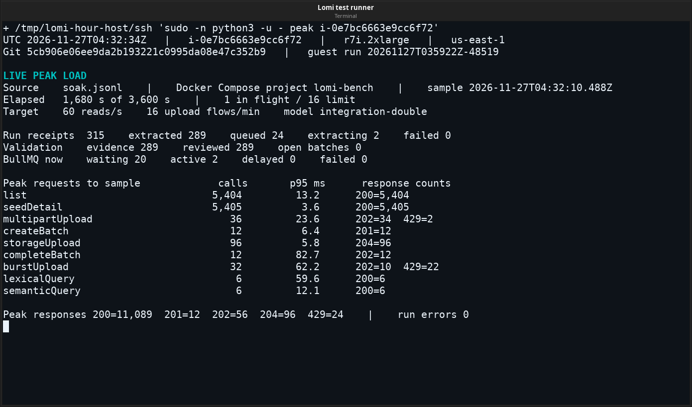
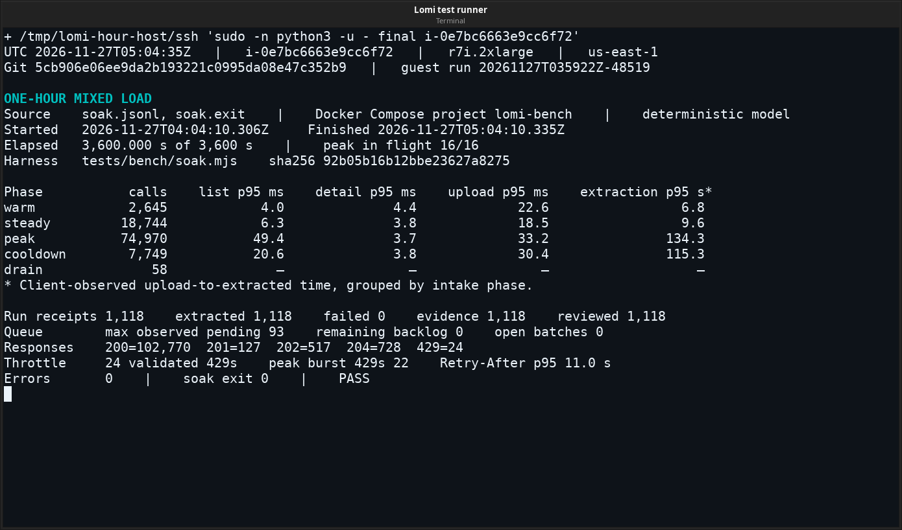

# Extraction pipeline measurements

## AWS measurements, 27 November 2026

The isolated `r7i.2xlarge` guest in `us-east-1` ran the client, API, PostgreSQL, Redis, storage, worker and model double on one host. The baseline used Node v24.22.3, eight logical CPUs, two extraction slots and a fixed three-second model delay. HTTP latency includes response-body transfer over loopback. The invoice fixture exercises API and worker behavior. Browser rendering, WAN latency and external provider capacity require separate measurements.

### Eight-invoice baseline

All eight uploads returned HTTP 202 and extracted with verified evidence. PostgreSQL recorded eight attempts. The batch completed at 0.63 documents/s. The longest queue wait was 9.47 s. Each 429 in the manifest burst advertised a 48 s retry window. [Baseline JSON](./baseline.json)

| Measurement                                                    | Samples |     p50 |     p95 |     p99 |
| -------------------------------------------------------------- | ------: | ------: | ------: | ------: |
| Library list, baseline                                         |     104 |  3.1 ms |  4.0 ms |  6.9 ms |
| Invoice detail, baseline                                       |     104 |  4.1 ms |  5.8 ms | 14.3 ms |
| Library list, during extraction                                |     104 |  2.8 ms |  3.7 ms | 24.6 ms |
| Invoice detail, during extraction                              |     104 |  3.6 ms |  4.6 ms | 25.3 ms |
| Upload request to 202                                          |       8 | 28.1 ms | 53.1 ms | 53.1 ms |
| Version created to first claim, PostgreSQL                     |       8 |  3.44 s |  9.47 s |  9.47 s |
| First claim to extracted, PostgreSQL                           |       8 |  3.02 s |  3.03 s |  3.03 s |
| HTTP 202 to client observing extracted                         |       8 |  6.59 s | 12.60 s | 12.60 s |
| Burst requesting upload manifests, 12 HTTP 201 and 20 HTTP 429 |      32 |  1.5 ms | 22.4 ms | 22.4 ms |

### One-hour soak results

From 04:04:10 to 05:04:10 UTC, the client completed **99,598 library and detail reads**. All **1,118 accepted invoices** extracted, passed the evidence checks and received the intended vendor correction. The run ended with zero failed extractions, open batches, outstanding invoices or harness errors. Both harness processes exited 0. The run summary includes the tested commit, image ID, harness hashes, assertions and counts by operation and HTTP status. [Run summary](./run.json) · [Original soak events, gzip](./soak.jsonl.gz)

| Phase    | List + detail HTTP 200 | Reads/s | List p95 / p99 (ms) | Detail p95 / p99 (ms) | PDFs accepted / observed extracted during phase | Max queued at a status poll | HTTP 429 |
| -------- | ---------------------: | ------: | ------------------: | --------------------: | ----------------------------------------------: | --------------------------: | -------: |
| Warm-up  |                  2,400 |    4.00 |           4.0 / 4.5 |             4.4 / 4.8 |                                         25 / 25 |                           2 |        0 |
| Steady   |                 17,999 |   20.00 |           6.3 / 6.7 |             3.8 / 4.1 |                                       150 / 148 |                           0 |        0 |
| Peak     |                 72,000 |   60.00 |         49.4 / 57.3 |             3.7 / 7.9 |                                       880 / 794 |                          91 |       24 |
| Cooldown |                  7,199 |   12.00 |         20.6 / 24.8 |             3.8 / 4.1 |                                        63 / 151 |                          86 |        0 |
| Drain    |                      0 |       0 |                   — |                     — |                                           0 / 0 |                           0 |        0 |

The peak admitted 44 PDFs/min while the client observed 39.7 extractions/min. At its highest sampled point, PostgreSQL-backed status showed **91 queued and two extracting**. Of the 880 invoices accepted during peak, p95 from starting the upload flow to first observing extraction was **134.25 s**. The first cooldown sample with an empty backlog came three minutes into cooldown. Averaged across all five phases, including drain, throughput was 0.311 extracted PDFs/s.

The generator reached its cap of 16 simultaneous tasks and recorded zero skipped schedules. The API returned 429 on 22 of the 32 burst uploads and two routine multipart uploads. All 24 carried valid retry windows (p95 11 s). Direct-to-storage upload completed 127 batches containing 728 PDFs. The client also checked reviewed, versioned citations for 110 lexical and 110 semantic queries.

Across 60 host samples, available memory stayed above 59.1 GiB and 1-minute load peaked at 1.71. The largest sampled container CPU reading was PostgreSQL at 145.36%, where 100% is one logical CPU. The API peaked at 19.0% and the worker at 7.27%. [Host samples, gzip](./resources.tsv.gz) · [Container samples, gzip](./container-stats.jsonl.gz)

The first capacity limit seen here was extraction queueing. For a higher sustained upload rate, repeat the peak at different worker concurrency settings under the target provider's quotas and compare queue age with extraction failures. List latency also rose as the library and read rate grew. Before sizing a 10,000-document deployment, measure the full-library query at fixed traffic and increasing collection sizes, then compare it with a paginated query. Production's `t3.medium` and external model need their own capacity measurements.





After the results were downloaded and verified, AWS terminated the test instance and deleted its root disk. The temporary SSH key pair and security group were also removed. [EC2 termination receipt](./ec2-termination.json)

## Cloud workload

Use a dedicated cloud test machine with Node 24 and Docker Compose, running the exact checkout under test. The integration override sets a deterministic model double with a three-second extraction delay. No external model account is needed. Ports 14000 and 19000 must be available. Start with a fresh project or wait a minute after previous upload tests for its quota to reset.

```sh
docker compose -p lomi-bench -f compose.yaml -f tests/integration/compose.yaml up --build -d
node tests/bench/load.mjs > load-results.json
sleep 60
node tests/bench/soak.mjs > soak.jsonl
docker compose -p lomi-bench -f compose.yaml -f tests/integration/compose.yaml stop
```

The harness checks the image bytes against the checkout's backend, worker, packages, lockfile, and fixtures. It verifies the mounted model double against the checkout and waits for the three seed documents to finish extracting. The JSON report includes the Git commit, tested source digest, image ID, runtime, CPU, worker concurrency, and configured fixture delay.

| Phase                           | Workload                                                                                                                                                                  | Measurement                                                                                                                                                          |
| ------------------------------- | ------------------------------------------------------------------------------------------------------------------------------------------------------------------------- | -------------------------------------------------------------------------------------------------------------------------------------------------------------------- |
| Baseline reads                  | Four clients alternate list and seeded invoice detail reads for eight seconds, with a 150 ms pause between responses and the next read.                                   | Per-operation counts, HTTP status codes and latency in milliseconds.                                                                                                 |
| Extraction and concurrent reads | Eight new invoice uploads, four at a time. Repeat the baseline read mix during the first eight seconds. Poll all accepted documents every 500 ms for up to three minutes. | Upload acceptance latency, read latency under extraction, status polling latency, complete outcomes and elapsed time from upload start to first observed completion. |
| Upload burst                    | Request 32 valid single-file upload manifests, four at a time.                                                                                                            | Counts of 201 and 429 responses and the distribution of advertised retry windows.                                                                                    |

For each operation the report includes sample count, p50, p95, p99, and maximum. An unexpected status, missing quota response, incomplete extraction, missing server timing, or missing invoice evidence makes the run exit nonzero. Each run retains its eight invoices and any granted upload manifests in the isolated project.

Compare read latency during extraction with the baseline for the same checkout. A read-only PostgreSQL query measures only the successfully observed v1 uploads from this run. `postgres.createdToFirstClaimMs` measures the interval from version creation to the first recorded worker attempt. `postgres.firstClaimToExtractedMs` measures the interval from that attempt to the version's extracted timestamp, including time between attempts for retried jobs. Both use PostgreSQL transaction timestamps. Compare `postgres.attempts` with `postgres.documents` to spot repeat attempts.

`uploadToExtractedMs` starts when the client submits the PDF. `acceptanceToExtractedMs` starts when it reads the HTTP 202 response. Both end when polling first observes completion. `observedBatchDocumentsPerSecond` divides completed documents by the duration of this eight-document extraction phase. Poll scheduling and response time affect these client measurements. The model double fixes provider latency and embedding output, so provider capacity needs a separate experiment. This bounded run has no measured 10,000-document throughput result.

## One-hour soak

The soak runs on the same isolated project after the baseline. It alternates library and document-detail reads, uploads fresh invoices, verifies extracted passages, corrects the vendor, and asks alternating lexical and semantic questions about a reviewed invoice. The report records actual responses and scheduled work skipped when the load generator reaches its concurrency limit.

| Phase    | Duration | Target reads/sec | Target upload flows/min |
| -------- | -------: | ---------------: | ----------------------: |
| Warm-up  |   10 min |                4 |                       2 |
| Steady   |   15 min |               20 |                       8 |
| Peak     |   20 min |               60 |                      16 |
| Cooldown |   10 min |               12 |                       5 |
| Drain    |    5 min |                0 |                       0 |

Three of every four scheduled upload flows submit one multipart invoice. The fourth obtains a signed batch, uploads two PDFs directly to storage and completes the batch. Peak batches contain eight PDFs. At peak the harness also attempts a one-time burst of 32 multipart uploads and checks that throttled requests receive a valid retry window. During drain it continues checking pending work and completing signed batches.

The default limit is 16 concurrent tasks. `SOAK_CONCURRENCY` accepts 4–32. `SOAK_SECONDS` defaults to 3,600 and accepts 120–7,200, scaling each phase proportionally. The harness polls document outcomes every five seconds and emits cumulative measurements and Redis queue samples every 30 seconds. Use the final `soak-result` event to check the actual duration, open batches, remaining backlog, evidence and review counts, status codes, latency percentiles, and error examples.

## Earlier local HTTP rate-limit check

A focused local run sent six sequential requests to a fresh Express listener on loopback. Its upload limit was three requests per minute. Each request sent an empty file list to `POST /uploads`. Timings include reading the response body. The first request includes connection setup.

| Request | HTTP status | Duration (ms) | Retry-After (seconds) |
| ------: | ----------: | ------------: | --------------------: |
|       1 |         400 |         101.8 |                       |
|       2 |         400 |           9.5 |                       |
|       3 |         400 |           7.9 |                       |
|       4 |         429 |           7.2 |                    60 |
|       5 |         429 |           5.7 |                    60 |
|       6 |         429 |           5.2 |                    60 |

The run used Node v24.13.0 on an AMD Ryzen 5 5500U with Radeon Graphics and measured the validation and rate-limit paths. The AWS workload above covers extraction throughput and database latency.
