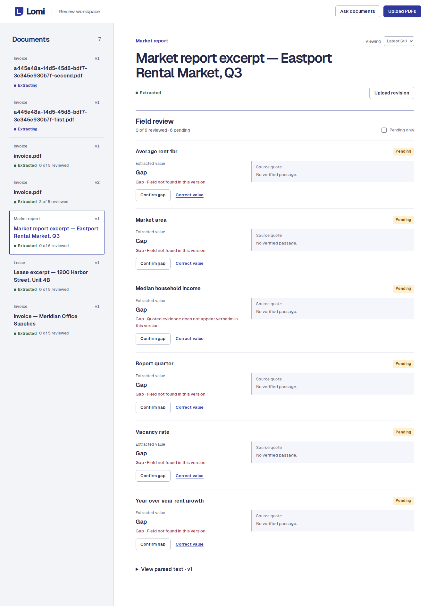
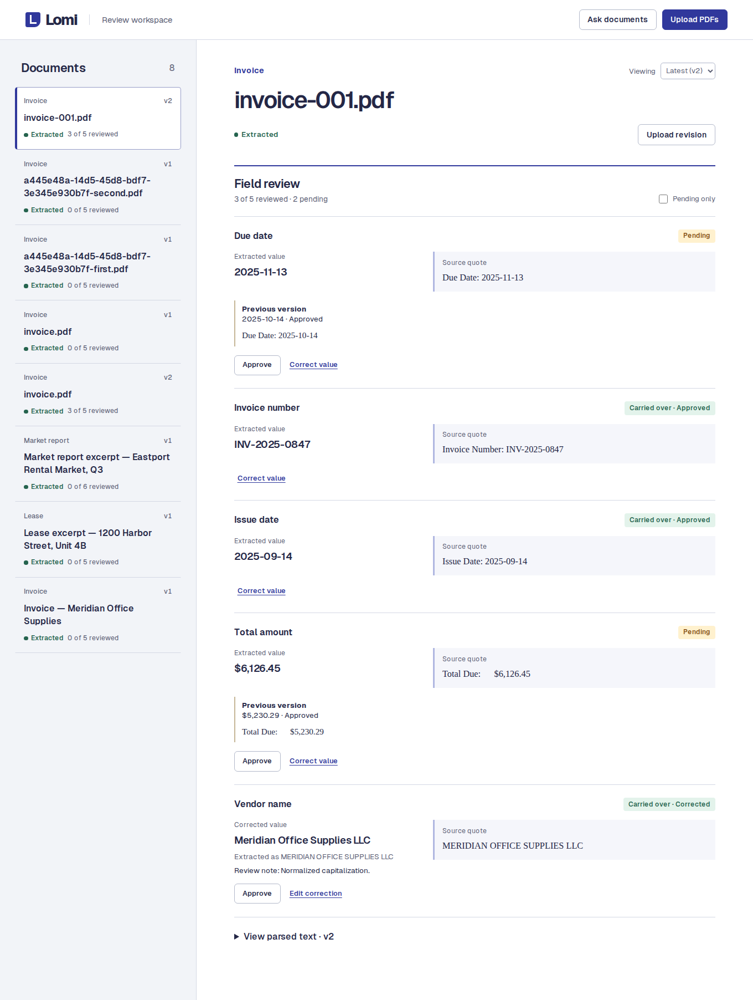

# Hosted reviewer workflow and recovery

On 28 November 2026 in India (27 November UTC), GitHub Actions tested commit `3e8615ec7e36ff1e62a62357a6e1ba8b19e3c9cd` on a disposable Ubuntu runner. Chromium used the dashboard, signed storage uploads, API and worker backed by PostgreSQL, Redis, MinIO and the deterministic model. The browser scenario passed in 15.2 seconds. The application job passed lint, type checking, the workspace tests against PostgreSQL and the build. Terraform checks also passed. The separate telemetry job failed on this SHA and staging deployment was skipped. [Actions run](https://github.com/rshdhere/lomi-assignment/actions/runs/46068341394)

The recovery test killed the worker during v2 extraction, observed seven Redis keys, flushed them to zero and restarted the running stack. V2 finished 94.297 seconds after interruption. All four approvals and one correction on v1 survived. V2 had five distinct fields, three carried reviews and two pending fields. A separate controlled provider fault reached a visible failed state, then a retry produced five fields. The suite also checked the in-flight revision conflict, exact evidence, versioned citations and partial batch replay. [Recovery events](ci-recovery.jsonl) · [Browser and recovery job](https://github.com/rshdhere/lomi-assignment/actions/runs/46068341394/job/140738999697)

## What the reviewer saw

Chromium opened the seeded market report and verified that the missing median household income appeared as a gap.

Chromium uploaded a fresh invoice, corrected its vendor, approved the remaining fields, and recorded the completed v1 review.

After uploading the revised PDF, Chromium verified that the due date and total returned to pending and that three reviews carried over. Switching the version selector back to v1 showed the original correction and read-only history.

