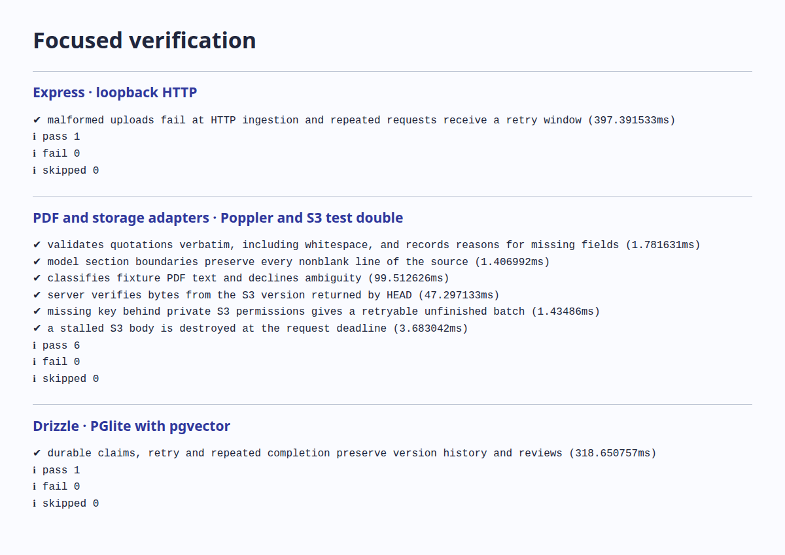

# Postgres storage

Run `pnpm --filter @repo/drizzle migrate` to apply the numbered SQL migrations. The Compose initializer runs this before seeding. A transaction-level advisory lock serializes migration runners.

A document owns immutable PDF versions. Each version pins the S3 object version and SHA-256 digest. A version holds its parsed text, document type and extraction state. Each expected field has one row per version. Reviews annotate that row with an approval or a correction. A new version links each field to its predecessor and copies a review only when the new validated quote matches the previous quote exactly. An identical quote can move anywhere in the PDF. Both an approval and a correction preserve the exact value the reviewer accepted, even if the model interprets the same passage differently on a later run. The attempt log retains the new model output. Historical reviews become read-only when a revision is accepted.

The worker periodically scans queued and expired versions. Claim tokens fence writes by competing workers. Values, reviews, chunks and the final status commit together. Extraction attempts retain prompts and raw responses for diagnosis. Postgres GIN indexes support lexical and metadata search, and HNSW indexes the 1,536-dimensional embeddings by cosine distance.

Run `pnpm --filter @repo/drizzle test` for the carry-over rule. Set `RUN_DB_TESTS=1` and point `DATABASE_URL` at a disposable pgvector database to include the race, retry, snapshot history and stale-worker tests.

The lifecycle test passed against an isolated PGlite 0.6.0 socket server with its pgvector extension. The test used the application's migrations and Drizzle client, verified recovery after an expired claim, and queried both lexical and vector indexes. A corrected value remained retrievable beside its original quote. The Compose Redis flush scenario requires a separate full-stack run.

