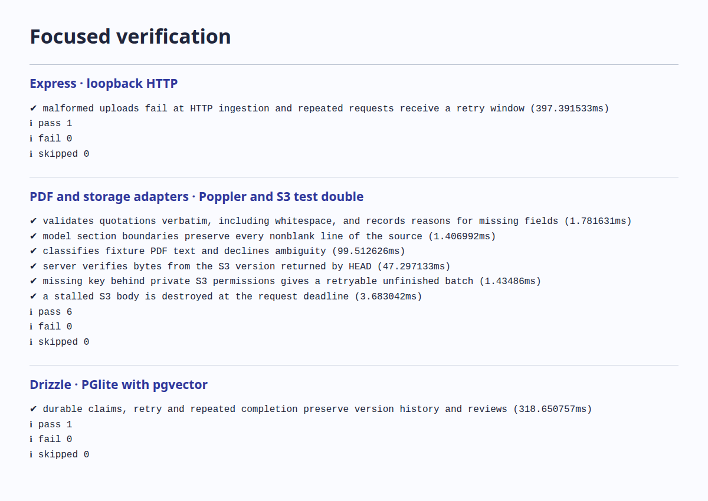

# Document services

Poppler provides structural PDF validation and layout-preserving UTF-8 text. The three extraction prompts use the field list in the fixture manifest's companion file, `fixtures/expected-fields.json`. Each response proposes field evidence and semantic section boundaries. The worker verifies quotes against the exact version text and slices sections from the same text. It embeds source passages and tags each section with the expected fields found in it.

The provider must implement Chat Completions with JSON Schema structured output and function calls, plus embeddings with 1,536 dimensions. Configure `OPENAI_MODEL`, `OPENAI_BASE_URL`, `OPENAI_API_KEY` and `EMBEDDING_MODEL` for the chosen deployment. The provider receives parsed source text. The parser accepts text PDFs with up to 120,000 characters of parsed text.

The classifier checks a source quote for its type prediction. Ambiguous predictions and unavailable providers fall back to patterns. Compare both classifiers on the same fixtures using `pnpm --filter @repo/services exec tsx src/benchmark.ts`. Each row includes the expected type, prediction and duration. The header identifies the CPU and model. The API column reports a skip when credentials are absent.

Query routing requires a model call to the retrieval tool. The answer generator receives source passages and matching review records for current versions. Review records carry corrected values with the original evidence. Each returned citation identifies a document and version.

Run `pnpm --filter @repo/services test` for fixture classification, evidence validation, gap handling and section boundary tests. Install Poppler utilities first, or use the app image which includes them.

## Fixture classifier measurement

One local run on an AMD Ryzen 5 5500U with Radeon Graphics (12 logical CPUs) measured regex classification after PDF text parsing. The invoice took 0.363 ms, the revised invoice 0.059 ms, the lease 0.065 ms and the market report 0.065 ms. All four predictions matched the fixture manifest. The runner had no provider key, so API latency and comparative accuracy remain unmeasured.

