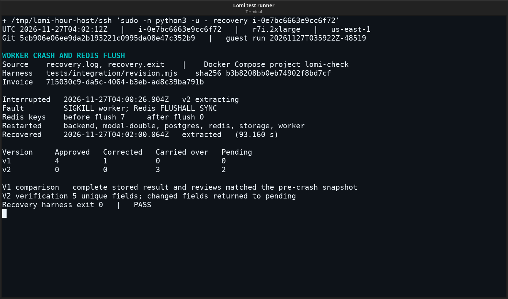

# Redis recovery

[Measurements, raw evidence and reproduction commands](../../docs/testing/2026-11-27/recovery.md)

The current `--recovery` suite also makes the isolated model provider return HTTP 503 on extraction. It uploads a fresh invoice, checks that the API reports the failure, restores the provider, and retries through the reviewer's endpoint. A duplicate retry must return HTTP 409. The successful retry must produce exactly five distinct fields with verified quotes on the original version. The suite prints a `provider-retry-verified` event when these checks pass.
